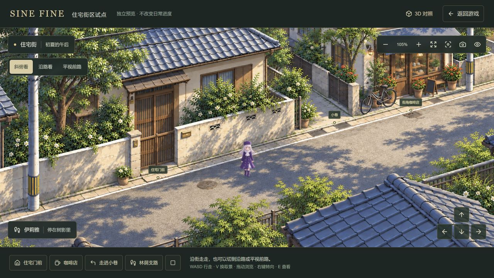
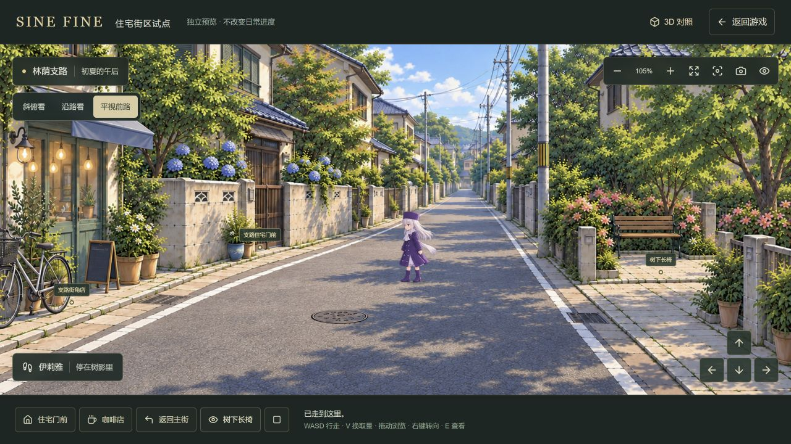

# SINE FINE｜融合版美术与 2D 街区制作规范

更新：2026-10-08。适用分支：`feat/art-samples`。

当前扩展按[冬木市2.5D制作：人物、街区与室内](fuyuki-25d-expansion.md)执行，覆盖三个美术部分。`/fate/city-art`已覆盖原地图7个分区、19条道路，以23个街景、69幅三档完整原画连接实际住宅通路；角色与室内继续独立制作。旧四段闭环是画风／操作样板，不能直接改名为冬木市。交付范围与未完成部分见[全城街道记录](fuyuki-full-city-streets-2026-10-08.md)。

本文把已经确认的住宅街试点整理为后续街区制作基准。先由用户保存、commit 和 push 当前成果，再按本文扩展一个连通街区。完成规范不等于全城美术或完整游戏已经完成。

旧操作样板为「主街 → 咖啡店旁小巷 → 林荫住宅支路」，页面为 `/fate/art-sample`。新地理扩展与旧样板的画面、人物和行走预览均独立于主游戏；原有生活、对话、记忆、活动、物品、时间、账号、云端和存档框架继续保留。3D 对照不属于本轮扩展范围。

后续制作以本文为当前规范；[第25条小样记录](art-sample-step-25.md)保留各轮过程、提示词和实测证据，早期尺寸、观察角度与素材版本按其日期理解。

## 1. 已确认的画风

融合版的三个支点：**自然光影、日式动画背景笔触、舒适且能行走的构图**。

2026-10-07当前扩展基准：用户已确认[住宅坂柔和版斜俯原画](../source/public/fate/city-art/miyama-residential-west-soft-v2.png)，沿路与平视也按这版边缘、光照和植栽层次绘制。后续街区、角色和室内以此为准；下方第25条图片保留为操作与细节参考，不代表需要恢复其较硬的明暗处理。

- 气质：普通日本住宅街的生活感，接近 Fate 日常场景的动画背景观感。建筑尺度可信，有院墙、门窗、排水、店面和生活痕迹。
- 色彩：奶油白与暖灰墙面、蓝灰瓦顶、暖木色、鲜活但有层次的绿植；受光温暖，阴影带天空的冷蓝灰。
- 柔和：通过笔触边缘、材质过渡、光照和空气层次实现。不能只降饱和度、加雾或把整幅画模糊。
- 精致：细节集中在门口、窗边、花木、招牌轮廓、栏杆、排水沟和常用交互处。远景适当概括，路面保留清楚的视觉通道。
- 风格边界：不用像素风、魔法学院、童话玩具屋、塑料质感、统一复制的建筑块；不恢复废弃的旧美术与旧 3D 实验。

原始画风参考：[已确认的融合版街道](art-direction/step-17-approved-anime-street.png)。下面是当前试点的实际运行截图，用于对照光影、构图和细节；移动修复以第十四轮记录为准。

## 2. 地点要有自己的特点

建筑先确定用途、轮廓、主要材质和入口，再配少量有辨识度的植物。整条街保持同一画风，但不能所有门口都用同一组花盆和树冠。

当前试点的区别可继续作为参考：

- 主街住宅：暖杉木门、浅色院墙、克制的金属件和白栀子，安静整洁。
- 咖啡店：木玻璃门、蓝灰布棚、细滚边、暖铜灯，珊瑚色天竺葵和香草盆栽。
- 小巷：较窄石板路、蕨、藤、薄苔和细草，墙边有变化，路中间保持通畅。
- 支路住宅：蓝紫绣球、不同门扇和墙面细节；与主街住宅属于同一城市。
- 支路街角店：白花、木制陈列与生活用品；摆设不挤占门前通路。
- 长椅口袋空间：粉杜鹃、木椅、开放铺装入口，能明确看见人可以走进去并坐下。

树种从树冠、枝条和叶形区分：樟树的厚亮长椭圆叶、榉树的疏透枝叶、枫的裂叶、银杏的扇叶、远处松的针叶。避免同一团树冠反复复制后只改颜色。植物种类和密度服务地点，不把每个空隙都填满花。

光影要求：

- 相邻画面共用时间、太阳方向和明暗关系，遮阴能找到对应树冠或建筑。
- 路面有连贯冠影、少量枝影和自然受光留白；不能铺满均匀碎点或装饰花纹。
- 阴影边缘有远近差异，阴影内部保留细节和天空补光，避免黑洞与过强光晕。
- 瓦片、墙砖、木纹、沥青纹理不应争抢人物和道路的注意力；避免重复纹样像地毯。

## 3. 连续街道的构建方式

**先确定连通布局，再画完整场景，再校准行走与多视角。** 不先堆独立建筑图，再用路面补空隙。

每个可行走街段是一幅完整环境：路面、路沿、院墙、入口、店面、树木、远景在同一个透视和光照下成立。需要遮挡或轻微纵深时，运行层可补深度与遮挡数据，视觉底图仍是连贯原画。

连续性分成两层：

- 同一街段内：镜头在同一幅画里跟随、浏览和缩放；人物经过建筑时不换成另一张建筑卡片。
- 相邻街段间：两幅画表现同一个路口或巷口。道路宽度、墙角、地面材质、门的位置、植物和前进方向必须对得上；通过共享入口走过去，再平滑衔接取景。

当前采用短暂遮罩更换完整取景，常规过渡约 0.48 秒；尚不是一张覆盖全街区的无限连续画，也不是自由旋转的完整 3D 空间。扩展时优先加强共享路口和前路可见性，不能用频繁黑屏掩盖布局不一致。

2026-10-08地图驱动版本以共有地面处约380毫秒的完整背景渐变连接住宅坂与旧街北段，保留屏幕脚底；上方0.48秒遮罩是旧小样实现。新街段配置见 `fate-city-art-scenes.ts`，原画、实际铺装、配准与验收提示记录在[旧街素材文档](art-direction/fuyuki-old-street-prompts.md)。

布局阶段必须明确：

- 街道主方向、转角、支路、坡度与相邻街段出口。
- 门前步道与落脚点，咖啡店入口，长椅前铺装和可离开的方向。
- 墙、建筑、树池、盆栽、自行车、柱子等实际阻挡，以及可见的开放铺装。
- 每个街段的视野边界和换景区域，留足人物脚底与身形的显示空间。

冬木市总体关系继续遵循[地图取舍](fuyuki-geography.md)：保留既有区域、地点编号和存档兼容；局部街巷可有自然弯折与不规则轮廓。当前住宅街试点是原创视觉样板，不能直接把样板里每栋房子宣称为原作地点。

## 4. 多视角共用一条真实路线

道路的三档取景为：

1. **斜俯看 `overview`**：看清道路、入口和周边关系，是布局参考视图。
2. **沿路看 `along`**：降低俯角，突出前路纵深和转弯方向。
3. **平视前路 `eye`**：使用另画的完整平视街景，人物随远近变化，建筑竖线稳定。

当前主街、林荫支路各有三幅取景，小巷另有一幅看向巷内的完整原画；小巷尚没有独立三档原画。进巷用巷内前路，返回道路后恢复玩家选定的道路档位。

在取景档位之上，支持水平 ±18°、高低 ±5°的有限连续观察。不能把斜俯视图大幅拉伸成平视，也不能把缺少建筑侧面和背面的 2D 图宣称为 360°环绕。

坐标需分清三层：

- **世界坐标**：人物、目的地、路线与地区连接的统一位置，不随取景改变。
- **原画坐标**：同一个地面位置在不同原画里的落脚点；各视图分别校准。
- **屏幕坐标**：叠加镜头平移、缩放和观察角度后的位置；点路面时按相反顺序转换回地面与世界坐标。

校准规则：

- 用路口、门槛、墙角、排水口、长椅入口等对应地面点建立配准；当前道路采用控制点与三角形映射。
- 每幅原画独立描可行走铺装和障碍；配准点存在不代表映射后的像素一定是路面。
- 各档视角应显示同一条可走路线。当前道路逻辑同时检查沿路和平视原画的落脚条件，兼顾参考布局；新增视图不能因为错画一段人行道，就强行把该人行道在所有模式中封死。
- 切视角保留世界位置、目的地、路线和倍率。脚底必须落在新画面的实际铺装上；无有效落点时修正原画或校准，不能将人物挪进墙上或悄悄退回俯视。
- 路口进出设置不同判定范围，避免反复切景。换景发生在两幅画都覆盖脚底的共享地面上。

## 5. 镜头、输入和移动

- 镜头使用缓动跟随，移动时适度预看前路；转弯逐步改变观察方向，停止后回稳。当前前路预看距离上限为 36 个样板坐标单位。
- 玩家手动调角度后保留其选择；自动转弯随行由玩家重新开启。切景不把手动角度、倍率或受控人物重置。
- 按键持续跨过换景时保持原来的世界行走方向，直到松开或改变输入，避免相同按键在新透视里突然转向。
- 手动行走、点地前往和触控方向键共用落脚判断；手动输入取消旧的点地路线，停止、失焦和打开交互卡片不留下持续按键。
- 斜向输入归一化；按帧时间推进，恢复页面后的大间隔有上限。透视造成的远近变化需纳入步幅，不靠一条全屏固定像素速度硬推。
- 逐小段检查实际经过的地面；连续短拐点可以在一帧内推进，但不能连成穿过墙角的捷径。圆滑路线的前后半段都要检查。
- 受阻可以有限重新寻路；当前自动路线最多重试两次，仍无通路时明确停下，避免无休止绕路。

**路沿输入规则必须保留：** 正面按向墙或路沿时停在接触点；明显沿边的输入才允许顺边移动。当前比较的是实际屏幕输入与边缘方向，包含观察角度，偏转超过 30°时不把人自动带着横移。玩家主动沿边、后退、重新选择开放地面仍能离开。

碰撞以脚底接触面判断，墙、花坛和道具保持阻挡；不能因为人物中心落在路面，就允许脚底跨墙。人物被阻挡时，不应继续滑动或原地循环迈步。

## 6. 人物动作、门前与长椅

人物延续已确认的伊莉雅身份、服饰与自然比例，动作有重心转移、适度屈膝和相反摆臂，发梢与衣摆克制随动。以后增加人物需分别验证身份、体型和动作，不把同一套外形直接套给全体居民。

- 当前行走是四方向、每方向六帧；静止用该方向的休息帧，帧序随实际位移推进。
- 逐帧测量身体中心、脚底和高度，运行时对齐。保留透明像素，不能用压缩站姿、改变身体长度或快速跳帧掩盖脚底不稳。
- 世界位置表示地面落脚点；远近比例、绘制锚点和点击转换必须一致，不能把角色图片左上角当作站位。
- 遮挡要对应真正的前景物体。开放道路上的人物保持可见，不能因粗略屋顶遮罩突然消失。

门前交互：

- 路面要连到实际门前铺装，不能只有远处的可点击图标。
- 保存门前可站位置、接近路线和交互范围，保持墙、盆栽等实际阻挡；按 E 或按钮打开对应地点。
- 地点标记不要遮住人物或门槛，图标点击不要误当成点地行走。
- 当前样板住宅与店面提供门前查看，尚未制作样板室内与主游戏进屋对接。

长椅交互：

- 状态为「站立 → 走向长椅 → 坐下」。路线完成且真的到达椅前才坐下，取消或被挡不能稍后凭空坐下。
- 世界位置留在椅前安全铺装；坐姿另用每个视图的椅面与臀部锚点对齐，不能让可走位置钻进椅子碰撞体。
- 三档视角分别有匹配坐姿；换取景保留坐姿和世界坐标。E、起身按钮或方向输入可起身，新目的地取消旧坐下意图。
- 使用独立坐姿素材，不缩短站立人物来假装坐下。当前坐椅是视觉交互，不会推进游戏时间或恢复疲劳。

## 7. UI 与操作发现性

- 延续深绿／炭灰底、米白文字、克制金色高亮，与融合版场景协调；控制区有清晰边界、焦点和触控反馈。
- 保留明确的取景档位、缩放、回到人物、地点与停止入口；观察、浏览与行走的模式切换需可理解。
- 面板和地点标记尽量让出道路、人物与前路；窄屏主要动作仍可触达，不能靠把整个桌面 UI 等比缩小解决。
- 到达、受阻、无法前往、坐下、起身等反馈描述真实状态。不能在路线被中断时显示「已到达」，也不能把普通人行道误报为建筑。
- 键盘、鼠标和触控的行为保持一致；输入框与弹窗获得焦点时，游戏方向键不抢输入。
- 主游戏已有交谈、时间与走速设置、传送、手账等功能的语义保持。以后对接场景时再接入这些操作，不在独立样板里伪造生活变化。

## 8. 当前有效素材与实现入口

既有场景素材在 `source/public/fate/art-sample/`，第26条新增素材在 `source/public/fate/block/`。当前十幅背景均为 **1672×941 不透明 PNG**：

- 主街：斜俯看 [residential-cafe-v5.png](../source/public/fate/art-sample/residential-cafe-v5.png)，沿路看 [main-road-along-v4.png](../source/public/fate/art-sample/main-road-along-v4.png)，平视 [main-road-eye-v4.png](../source/public/fate/art-sample/main-road-eye-v4.png)。
- 小巷：[cafe-alley-facing-v4.png](../source/public/fate/art-sample/cafe-alley-facing-v4.png)。
- 林荫支路：斜俯看 [leafy-lane-v4.png](../source/public/fate/art-sample/leafy-lane-v4.png)，沿路看 [leafy-road-along-v4.png](../source/public/fate/art-sample/leafy-road-along-v4.png)，平视 [leafy-road-eye-v4.png](../source/public/fate/art-sample/leafy-road-eye-v4.png)。
- 榉树坡道：斜俯看 [zelkova-slope-v1.png](../source/public/fate/block/zelkova-slope-v1.png)，沿路看 [zelkova-along-v1.png](../source/public/fate/block/zelkova-along-v1.png)，平视 [zelkova-eye-v1.png](../source/public/fate/block/zelkova-eye-v1.png)。
- 行走：[illya-walk-v1.png](../source/public/fate/art-sample/illya-walk-v1.png)，1536×1024，RGBA，6列×4行，每格256像素。
- 坐姿：[illya-sit-v1.png](../source/public/fate/art-sample/illya-sit-v1.png)，1254×1254，RGBA，2列×2行，每格627像素；前三格用于三档取景，第四格未使用。

以实际素材与引用为准，不能按提示词要求的分辨率或文件后缀猜测运行版本。旧稿用于历史对照，不自动加载进新街区。

实现分工：

- [页面组件](../source/components/fate-art-sample.tsx)与[样式](../source/components/fate-art-sample.module.css)：输入、镜头、动画循环、人物状态、地点与操作 UI。
- [样板基础](../source/lib/fate-art-sample.ts)、[小巷和地区连接](../source/lib/fate-art-alley.ts)：参考坐标、街段关系、门前与连接位置。
- [街区配置](../source/lib/fate-art-block.ts)、[弯街配准](../source/lib/fate-art-extension.ts)、[纯2D总览](../source/components/fate-block-map.tsx)：双向连接、地点统一入口、同一落脚点的多视图转换与街区浏览。新街段实际生成提示见[榉树坡道素材记录](art-direction/step-26-block-prompts.md)。
- [取景管理](../source/lib/fate-art-views.ts)、[道路配准](../source/lib/fate-art-view-registration.ts)、[原画路面](../source/lib/fate-art-road-ground.ts)：视图选择、坐标转换、真实铺装与障碍。
- [导航](../source/lib/fate-art-navigation.ts)：共享可走地面、点击前往、路线检查、碰撞与路沿输入意图。
- [镜头缓动](../source/lib/fate-art-camera.ts)、[有限观察投影](../source/lib/fate-art-depth.ts)、[投影运行层](../source/lib/fate-art-depth-runtime.ts)：跟随、预看、正逆投影与有限纵深。
- [逐帧对齐](../source/lib/fate-art-sprite.ts)、[长椅状态与锚点](../source/lib/fate-art-bench.ts)：人物落脚与坐姿。

完整生成／编辑记录：[环境精修](art-direction/step-25-detail-identity-prompts.md)、[道路多视角](art-direction/step-25-road-view-prompts.md)、[长椅坐姿](art-direction/step-25-bench-seat-prompts.md)。这些文件保存历史提示词，未来输入应选上面的当前素材与融合版参考，不依赖临时目录里的中间图。

## 9. 每条新街道的制作步骤

1. **写街段简报。** 明确用途、相邻街段、入口／出口、太阳方向、建筑特点、植物主题、能做的交互。先核对既有地图关系。
2. **确定地面布局。** 画道路、路口、门前步道和互动空间，规定共享入口与障碍；检查双向能走、能到门前、能转身离开。
3. **画完整斜俯场景。** 用当前融合版作参考，保持道路可读；让建筑和花木有本街段特点，同时保留安全通路。
4. **补沿路与平视取景。** 以同一布局和关键地标约束绘图，位置、门数、道路宽度、太阳方向与植物身份一致。狭窄弯巷按实际需要补面向前路的取景。
5. **分别描路面并配准。** 逐幅标记地面、障碍和对应点，检查转换往返、脚底接触范围，以及各视图共用的连续可走通道。
6. **接导航与镜头。** 注册街段连接、方向、共享入口和切景范围；测试持续按键、点地路线、转弯预看、手动角度、倍率和返回路径。
7. **接门前与小交互。** 至少验证实际门前到场；有长椅就补坐姿和离椅路径。有趣的空间应提供可见用途，避免只有大量空门和无效图标。
8. **完成实机验收再接下一段。** 保存素材版本、布局／锚点／碰撞数据、测试与运行截图；通过后再扩大连接范围。

验收按 [低流量工作流](low-traffic-development.md) 执行：位置／碰撞／焦点先用本地状态与测试检查，截图不用于等待或轮询。只在视觉有实质变化和关键验收点保留运行截图，常规 AI 检查用裁剪或压缩副本；正式母版无损保存，已生成素材优先复用。

纯精修可改材质、光影、叶形和花纹，但要保持已经验证的路口、门槛、路沿与道具占地。只要增删障碍、移动入口或改变铺装，就必须同步修改所有相关视图、配准和碰撞，再做行走回归；不能只换底图。

新街段交付需有：完整取景素材、相邻关系与入口数据、独立路面与配准点、地点／坐姿锚点、操作与衔接验证、实际运行截图。生成图看起来好看只完成了其中一部分。

## 10. 扩展整个街区的顺序

用户已推送第25条基准。2026-10-07第26条第一轮已形成四段闭环及纯2D总览：以下1—4步的场景与操作层已实现，第5步的生活适配与联合试玩仍待完成，详见[街区扩展记录](art-block-step-26.md)。

1. **整理场景数据入口。** 用统一配置登记场景、取景、连接口和地点，目前注册主街／小巷／支路／坡道。新区域还需同步实现坐标转换、原画路面及碰撞，不能仅填名称就声称能自动扩展。
2. **接一处新路口和短街段。** 先做小范围双向连接，补对应多视角；验证从现有样板走出去再走回来。不能一开始批量绘完后才发现坐标或接缝不成立。
3. **逐段组成一个街区。** 按实际地图关系增加住宅段、生活店面、支巷和停留空间，让不同路线有区别。允许自然弯折、错落入口与不规则地块，避免规则棋盘或重复贴图。
4. **做街区级操作与寻路。** 检查跨多段路线、分岔选择、反向返回、地图定位、拖动缩放和地点发现；每次扩展都回归当前门前、长椅与路沿。
5. **对接已有生活玩法并联合试玩。** 街区稳定后映射既有地点与人物站位，让居民实际前往活动、玩家实际到场。继续保留人物专属对话、记忆、活动结果与存档兼容，先验证少量人物和一天生活，再增内容。

接入主游戏使用明确的坐标／地点适配层；不要把美术样板原画像素写入既有世界存档，也不要以美术扩展为由重做基础机制。一个街区通过视觉和玩法试玩后，再讨论其他区域；3D 另行推进。

## 11. 每轮验收清单

### 视觉与街道连续性

- [ ] 建筑、院墙、地面透视与接触关系成立，没有浮空建筑、裸露拼接缝或路面空洞。
- [ ] 相邻街段共享路口能认出来，方向、材质、光照与主要地标一致；进巷能看清接下来的路。
- [ ] 三档视角都维持融合版，植物和建筑有个性，纹理与阴影不过密。
- [ ] 人物比例、衣着与场景一致；迈步自然，脚底稳，静止不滑动，坐姿贴合椅面。

### 移动、镜头与交互

- [ ] 三档取景中可往返，切换前后世界位置与目的地一致，平视不会自动变成俯视。
- [ ] 持续按键经过路口不突然反向、乱跳、反复切景、飞到墙上或消失。
- [ ] 路沿正面顶住会停；主动沿边、后退和换方向可以离开，斜路沿不擅自把人带着横移。
- [ ] 可见人行道与门前铺装连通；墙、盆栽、树池和道具确实挡住，点击建筑给清楚反馈。
- [ ] 点地路径不过墙角、不无故绕远，圆滑转角也不穿模；受阻后可重新前往。
- [ ] 能走到门前按 E；长椅先到场再坐下，三档坐姿、起身、取消和离开都正常。
- [ ] 手动角度、缩放、拖动、人物跟随与定位一致；点击按当前镜头落到正确地面。
- [ ] 20／60／120fps 和观察角度边缘都有移动检查；失焦、停止、弹窗和恢复页面无残留输入。
- [ ] 桌面与窄屏可操作，交互不遮主要路面；模拟手机检查与实体触屏实测分别记录。

### 功能与运行

- [ ] 素材完整加载，切景没有明显首次卡顿，页面与运行服务无新增异常。
- [ ] 按需要预加载相邻场景，避免每帧重复校准或全街区全量计算；离开页面释放相关资源。
- [ ] 自动检查、lint、类型检查与生产构建通过；浏览器完整走通新增街段的双向流程。
- [ ] 对接生活后再验证多人活动、时间／走速设置、对话与记忆、存档恢复及旧档兼容。
- [ ] 记录本轮改变、实际验证范围和剩余问题，静态截图与功能测试不代替用户试玩。

命令在 `source/` 中执行：`npm test`、`npm run lint`、`npm run build`；当前构建包含类型检查。独立类型检查入口为 `npm run typecheck`，本地环境说明见[开发说明](local-development.md)。

## 12. 当前验收基线与未完成部分

2026-10-06 第十四轮实现的验证快照：**386 项测试通过，lint 与生产构建通过，构建内类型检查通过**；页面复测了三档取景持续顶边、改向及长椅交互。详细范围见[小样记录](art-sample-step-25.md)；[路沿实测截图](art-direction/step-25-2d-curb-intent-v14.png)与[长椅坐姿截图](art-direction/step-25-2d-bench-seat-v13.png)已入仓库目录。上述为当时的验证快照，不能代替后续版本的回归。

2026-10-07街区第一轮更新：397项测试、lint与生产构建通过（含类型检查），四段双向闭环、多段导航、新门前及纯2D总览见[街区扩展记录](art-block-step-26.md)。亲人路过招呼已接入主游戏规则；街区预览本身尚未写入主游戏存档。

2026-10-08按用户“一口气补齐剩余街区”的指令，原地图街道已扩展到7个分区、19条道路、23个场景及69幅三档完整原画；共有路口、两座桥、河岸和两户独立庭前通路形成同一网络。新增共享边缘地面、真实道路交点跨街、分段全城路线和按需加载，记录见[全城街道交付](fuyuki-full-city-streets-2026-10-08.md)。

仍需后续完成：生活与NPC的地点／坐标适配及联合日常试玩、更多人物动作、室内、高清母版、环境音与更广设备实测。昼夜／天气画面若要加入，需保持相同布局和行走数据，另做对应光照与表现，不能靠色罩就宣布完成。

下一步依据第10节第5步对接生活。纯2D总览是局部路网平面图，2.5D是同一位置的实际街道行走，共用位置与目的地。美术与操作基准继续保留，不重回建筑图片拼接，也不重启全城3D制作。
